  <!-- Cinematic Animated SVG Hero Banner -->
  

    

  <!-- Animated Typing Headline -->
  

    

  <!-- Professional Connect Badges -->
  
  &nbsp;
  
  &nbsp;
  

    

  <!-- Profile Visitor Counter -->
  

 

 

## About Me

I am a second-year **B.Tech Computer Science and Engineering (Artificial Intelligence & Machine Learning)** student at **MIT Academy of Engineering, Pune, India**.

My technical work focuses on developing intelligent applications, engineering scalable software systems, and exploring practical implementations where mathematics, computer architecture, and artificial intelligence converge.

- **Focus Areas**: Machine learning and deep learning pipelines, agentic architectures, full-stack application development, and scientific visualization.
- **Background**: Project experience across deep learning fault classification, urban risk intelligence, systems programming in C++, and programmatic mathematical animation with Manim.
- **GitHub**: Discover my open-source code and development work at [github.com/Siddharth9520](https://github.com/Siddharth9520).

 

 

## Technical Expertise

<table>
  <tr>
    <td width="28%"><b>Programming Languages</b></td>
    <td>
      
      
      
      
    </td>
  </tr>
  <tr>
    <td><b>AI & Machine Learning</b></td>
    <td>
      
      
      
      
      
    </td>
  </tr>
  <tr>
    <td><b>Development</b></td>
    <td>
      
      
      
      
      
    </td>
  </tr>
  <tr>
    <td><b>Tools & Technologies</b></td>
    <td>
      
      
      
      
      
      
    </td>
  </tr>
</table>

 

 

## Featured Projects

<table>
  <tr>
    <td width="50%" valign="top">
      <h3><a href="https://github.com/Siddharth9520/nexora-intelligence-platform">1. NEXORA Intelligence Platform</a></h3>
      
<b>Evidence-First Threat & Incident Intelligence Platform</b>

      
An intelligence analysis platform featuring interactive knowledge graphs, geospatial heatmaps, modus operandi analysis, and temporal event reconstruction powered by open-model AI.

      

        
        
        
        
      

      
<a href="https://github.com/Siddharth9520/nexora-intelligence-platform"><b>View Repository &rarr;</b></a>

    </td>
    <td width="50%" valign="top">
      <h3><a href="https://github.com/Siddharth9520/power-grid-fault-detection">2. Power Grid Fault Detection</a></h3>
      
<b>AI-Powered Electrical Fault Classification</b>

      
An electrical fault classification system combining Convolutional Neural Networks (CNN) for spatial feature extraction, Bidirectional LSTM (BiLSTM) for temporal pattern analysis, and Multi-Head Attention mechanisms.

      

        
        
        
        
      

      
<a href="https://github.com/Siddharth9520/power-grid-fault-detection"><b>View Repository &rarr;</b></a>

    </td>
  </tr>
  <tr>
    <td width="50%" valign="top">
      <h3><a href="https://github.com/Siddharth9520/LabForge-AI">3. LabForge-AI</a></h3>
      
<b>AI Lab Manual & Experiment Generator</b>

      
An AI documentation tool utilizing IBM watsonx Orchestrate and Retrieval-Augmented Generation (RAG) to generate structured lab manuals, viva questions, observation tables, and safety guidelines.

      

        
        
        
        
      

      
<a href="https://github.com/Siddharth9520/LabForge-AI"><b>View Repository &rarr;</b></a>

    </td>
    <td width="50%" valign="top">
      <h3><a href="https://github.com/Siddharth9520/FloodLens-AI">4. FloodLens-AI</a></h3>
      
<b>Explainable Urban Waterlogging Risk Intelligence</b>

      
A full-stack, explainable machine learning platform for urban waterlogging risk assessment. Features interactive geospatial mapping with Leaflet, model explainability via SHAP, and a FastAPI backend.

      

        
        
        
        
      

      
<a href="https://github.com/Siddharth9520/FloodLens-AI"><b>View Repository &rarr;</b></a>

    </td>
  </tr>
  <tr>
    <td width="50%" valign="top">
      <h3><a href="https://github.com/Siddharth9520/expanding-universe-doppler-effect-ManimProject">5. Expanding Universe &mdash; Doppler Effect</a></h3>
      
<b>Scientific Animation & Astrophysics Simulation</b>

      
A mathematical animation project created with the Manim engine visualizing the Doppler Effect, cosmological redshift, blueshift, and the metric expansion of spacetime through programmatic mathematical rendering.

      

        
        
        
        
      

      
<a href="https://github.com/Siddharth9520/expanding-universe-doppler-effect-ManimProject"><b>View Repository &rarr;</b></a>

    </td>
    <td width="50%" valign="top">
      <h3><a href="https://github.com/Siddharth9520/Virtual-Memory-Simulator">6. Virtual Memory Simulator</a></h3>
      
<b>Page Replacement & Memory Hierarchy Simulator</b>

      
An educational operating systems simulator that models, visualizes, and benchmarks three foundational page replacement algorithms: FIFO, Least Recently Used (LRU), and Optimal (Belády's MIN).

      

        
        
        
        
      

      
<a href="https://github.com/Siddharth9520/Virtual-Memory-Simulator"><b>View Repository &rarr;</b></a>

    </td>
  </tr>
</table>

 

 

## More Projects

  
<b>A. Systems & Software Engineering</b>

   
  <ul>
    <li>
      <b><a href="https://github.com/Siddharth9520/OS_Assignments">OS_Assignments</a></b> &mdash; Operating systems practical assignments implemented in C++, covering process scheduling, memory allocation, multi-threading, and synchronization.
    </li>
    <li>
      <b><a href="https://github.com/Siddharth9520/Problem-Solving-Using-OOP-CPP">Problem-Solving-Using-OOP-CPP</a></b> &mdash; Object-oriented programming principles, class designs, inheritance, polymorphism, and algorithmic implementations in C++.
    </li>
    <li>
      <b><a href="https://github.com/Siddharth9520/Hospital_Management_System">Hospital_Management_System</a></b> &mdash; Interactive healthcare management dashboard application managing hospital records, appointments, and operational workflows.
    </li>
    <li>
      <b><a href="https://github.com/Siddharth9520/Platformer-Game">Platformer-Game</a></b> &mdash; 2D platformer game developed in Godot Engine using GDScript.
    </li>
  </ul>

 

  
<b>B. Data Science & Blockchain</b>

   
  <ul>
    <li>
      <b><a href="https://github.com/Siddharth9520/Global-Superstore-PowerBI-Project">Global-Superstore-PowerBI-Project</a></b> &mdash; Interactive Power BI business intelligence dashboard using the Global Superstore dataset with Snowflake Schema modeling, DAX measures, and analytical storytelling.
    </li>
    <li>
      <b><a href="https://github.com/Siddharth9520/academic-record-blockchain">academic-record-blockchain</a></b> &mdash; Python-based blockchain project demonstrating tamper-resistant academic record storage and verification using SHA-256 hashing.
    </li>
    <li>
      <b><a href="https://github.com/Siddharth9520/Final_blockchain_project">Final_blockchain_project</a></b> &mdash; Full-stack decentralized marketplace built with Polygon, Solidity smart contracts, IPFS, and Next.js.
    </li>
    <li>
      <b><a href="https://github.com/Siddharth9520/Essentials-of-Data-Science">Essentials-of-Data-Science</a></b> &mdash; Data science notebooks covering data cleaning, statistical analysis, and exploratory data visualization.
    </li>
  </ul>

 

  
<b>C. Academic & Technical Learning</b>

   
  <ul>
    <li>
      <b><a href="https://github.com/Siddharth9520/DSA-Practical-Assignments">DSA-Practical-Assignments</a></b> &mdash; Practical Data Structures and Algorithms implementations in C++ for B.Tech CSE (AI & ML).
    </li>
    <li>
      <b><a href="https://github.com/Siddharth9520/portfolio">portfolio</a></b> &mdash; Responsive developer portfolio website showcasing engineering projects and technical work.
    </li>
  </ul>

 

 

## Achievements & Certifications

### Achievement
- **Team AlgoAnimators** &mdash; First Prize, Mathematics & Technology category, National Mathematics Day 2025, MIT Academy of Engineering.

### Certifications
- **Anthropic AI Fluency** &mdash; Anthropic
- **Codecademy JavaScript** &mdash; Codecademy
- **Google Cloud Trust & Security** &mdash; Google Cloud
- **Cisco AICTE Virtual Internship Program 2026 in Artificial Intelligence** &mdash; Cisco Networking Academy / AICTE

 

 

## GitHub Analytics

  <table border="0">
    <tr>
      <td align="center" valign="middle">
        
      </td>
      <td align="center" valign="middle">
        
      </td>
    </tr>
    <tr>
      <td colspan="2" align="center" valign="middle">
        
      </td>
    </tr>
  </table>

 

 

## Contribution Activity

  
<i>Every contribution moves me forward.</i>

  

 

 

## Connect With Me

  
Open for technical collaborations, internship opportunities, and software engineering discussions.

  
  &nbsp;&nbsp;
  
  &nbsp;&nbsp;
  

  

<!-- Animated Blue SVG Footer -->

  

